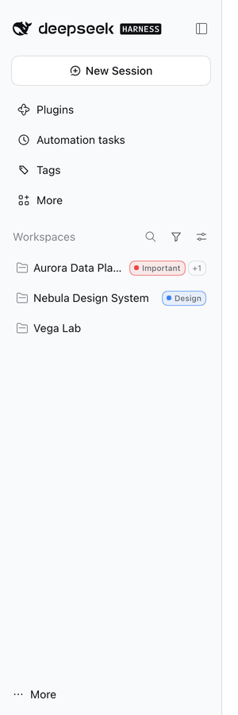
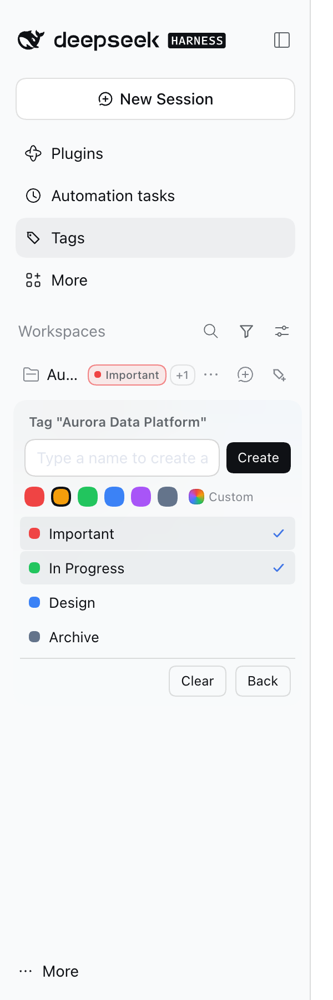
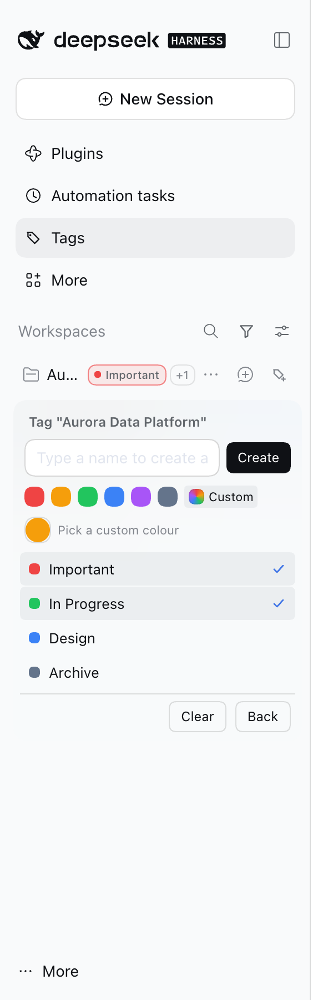
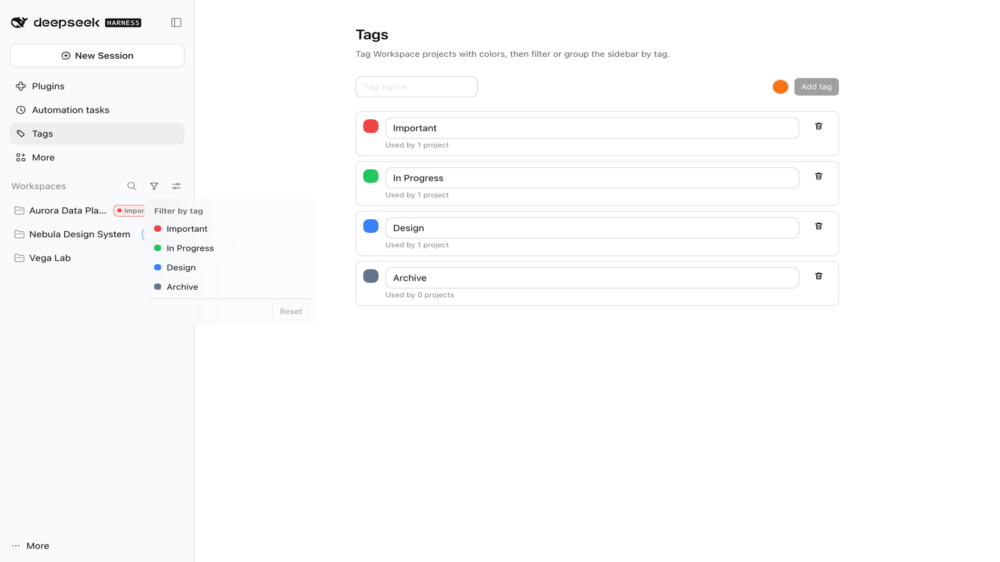
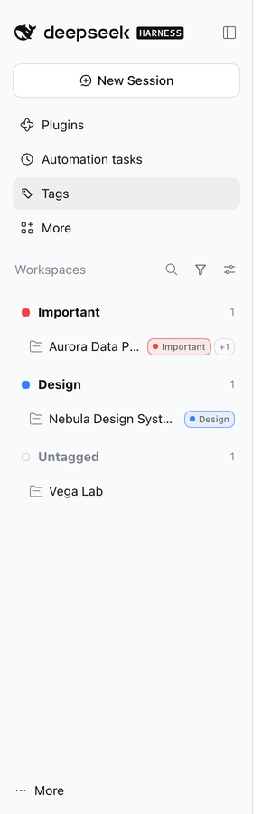
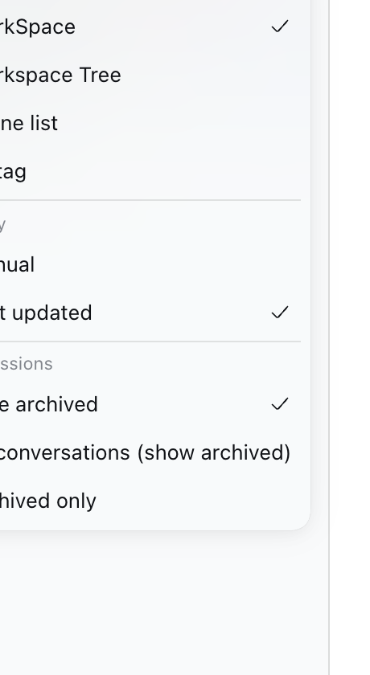
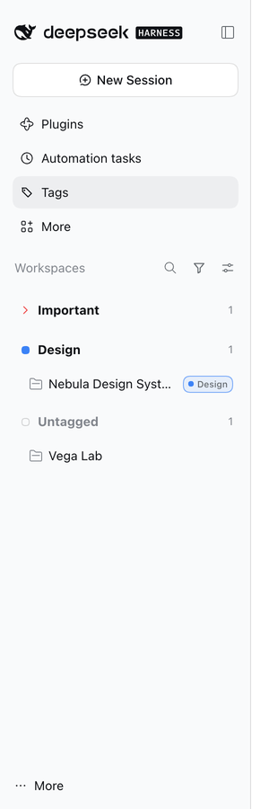
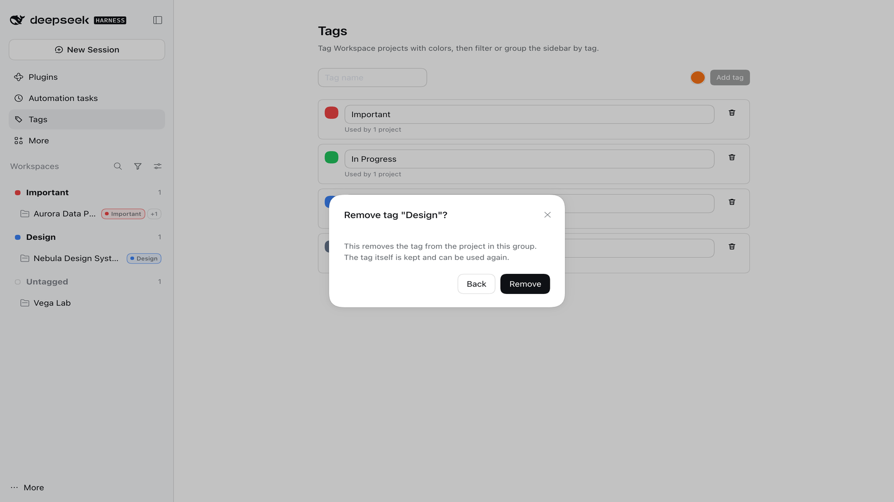
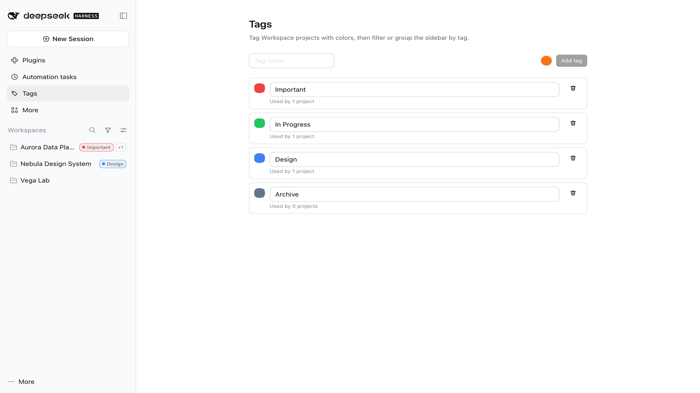

# Workspace Tags · dsh-workspace-tags

English | [中文](README.md)

> Colored tags for DeepSeek Harness workspace projects: chips beside project names, tag filtering in the sidebar, grouping workspaces by tag, and one page to manage every tag.

[](https://github.com/AlienGene/dsh-workspace-tags/actions/workflows/ci.yml)
[](LICENSE)
[](docs/COMPATIBILITY.md)


## Why

DeepSeek Harness lists workspaces by project name. Once there are more than a handful, it is hard to tell at a glance which projects are important, in progress, or design work.

This plugin adds colored tags to workspace projects:

- Tag chips beside project names (colored dot + tag-colored border)
- Inline tagging: type a new name and press Enter, or toggle existing tags
- A multi-select tag filter in the workspace header, with a fixed **Reset** at the bottom
- A **By tag** grouping mode in the view options
- A dedicated **Tags** page above the sidebar’s **More** row for renaming, recoloring, and deleting

The screenshots below show the UI in Chinese; the plugin ships English strings as well.

## Features

### Colored tags beside project names



Tags appear to the right of the project name: the chip contains a **colored dot**, its **border uses the tag color**, and the label follows the dot. One chip is shown at most; the rest collapse into `+N`. Hover the chip to see every tag on that project.

### Inline tagging



Hover a workspace row and click the tag button at the end of the row (or click an existing chip) to open the picker:

- Type a name and press **Enter**, or click the **Create** button to the right of the field: the tag is created and assigned immediately
- **Back** at the bottom closes the picker (it no longer reads like a create button)
- The color row offers **six presets**; only clicking **Custom** reveals the color input for an arbitrary color
- If the name already exists, the existing tag is assigned instead of creating a duplicate
- Click a tag row to toggle its assignment; **Clear** removes all tags from that project



### Filter by tag



A funnel icon appears in the workspace header once tags exist:

- The dropdown lists every tag and supports multi-select (union)
- A fixed **Reset** at the bottom clears the selection; no selection means show everything
- The selected count is shown on the icon
- When nothing matches, the list shows an empty state with a reset action

### Group by tag



View options (the slider icon in the workspace header) → grouping → **By tag**. The menu entry uses the same layout as the native grouping options: icon on the left, label on the right.



The list is grouped in tag creation order. Group rows use the same format as native workspace rows (34px tall, dot/chevron, 14px bold tag name, project count); the projects under a group are indented one level. Untagged projects go to **Untagged**. Selecting any native grouping mode exits this mode.

**Collapse**: click a group row (or press Enter/Space) to collapse/expand it. The row stays visible and keeps the count.



**Remove from group**: hover a group row and click **Remove**; after confirmation the tag is removed from every project in that group. The tag definition itself is kept and can be used again.



> A project appears once: with multiple tags it is grouped under the **earliest-created** tag (the chips still show all tags).
>
> **Remove** only unassigns the tag from the projects in that group; it does not delete the tag definition, and projects that use the same tag as a non-first tag elsewhere are untouched. The tag page and usage counts update immediately.

### Tags page



A **Tags** row is added above **More** in the sidebar panel list. It opens the tag manager:

- Add a tag (with a color)
- Edit the name inline (empty or duplicate names show an inline error)
- Click the swatch to open the preset palette or the system color picker
- Delete a tag (inline confirmation; removed from every project)
- See how many projects use each tag

## Install

The source is TypeScript. The release tarball is built by CI and includes `lib/` and `client/`, so installing it needs no local build.

```sh
# Web / CLI profile
dsh plugin --profile web add https://github.com/AlienGene/dsh-workspace-tags/releases/latest/download/dsh-workspace-tags.tgz
```

For the desktop app, fully quit the app first and use the CLI that ships with it:

```sh
"/Applications/DeepSeek Harness.app/Contents/Resources/runtime/cli/bin/dsh" \
  plugin --profile desktop add https://github.com/AlienGene/dsh-workspace-tags/releases/latest/download/dsh-workspace-tags.tgz
```

Then reopen the app.

### Plugin marketplace

DSH’s plugin market is **index-based**: there is no built-in central store. The **Discover** tab reads index sources that each profile adds. The npm package name `dsh-workspace-tags` is available and the package is publish-ready; after it is published to npm, community indexes that auto-discover npm packages with the `dsh-plugin` keyword and a `dsh.bundle` declaration (for example [REALOIYO’s DSH plugin index](https://realoiyo.github.io/dsh-plugin-market/index.json)) will list it, typically within six hours.

To browse it in DSH: **Plugins → Discover → Add index source**, paste the index URL, then install from the card. See [docs/MARKETPLACE.md](docs/MARKETPLACE.md) (Chinese) for the publication steps, index sources, and the promotion checklist.

### Local development

```sh
pnpm install
pnpm run build        # writes lib/ and client/
pnpm pack             # produces dsh-workspace-tags-<version>.tgz
dsh plugin --profile web add ./dsh-workspace-tags-<version>.tgz
```

## Usage

1. Open **Tags** in the sidebar and add a few tags, for example “Important”, “In progress”, and “Design”
2. Back in **Workspaces**, hover a project row, click the tag button, then toggle or type a tag
3. Click the funnel icon in the workspace header to filter by tags; **Reset** restores everything
4. Open view options → grouping → **By tag** to browse projects by tag

## Where data lives

- Tag definitions and project assignments: `~/.dsh/storages/dsh_tags.json` (DSH storage-domain / JSON backend, atomic writes, `0600`)
- Writes go through the authenticated `/api/dsh-tags/state` route (owner-only on this machine)
- Filters and the **By tag** choice are page state and reset on refresh; tag data survives restarts and port changes
- No network calls, no uploads, no telemetry

## Compatibility

- Built and verified against **DeepSeek Harness 0.2.1-rc.5**; `engines.dsh` is `>=0.2.1-rc.5 <0.3.0`
- The sidebar project row, header, and view menu currently expose no plugin slots, so the plugin augments the DOM for chips, buttons, the filter icon, and tag grouping; see [docs/DESIGN.md](docs/DESIGN.md)
- If a DSH upgrade changes the sidebar structure, usually only [src/client/dom/selectors.ts](src/client/dom/selectors.ts) needs updating; see [docs/COMPATIBILITY.md](docs/COMPATIBILITY.md)

## Development

```sh
pnpm install
pnpm run build      # tsdown: lib/ + client/client.js
pnpm run typecheck  # host + client + tests
pnpm run test       # Vitest (protocol / storage / route / store / DOM / grouping / bundle)
pnpm run check      # typecheck + build + test
```

All source is TypeScript (`.ts` / `.tsx`); tests use TypeScript + Vitest + jsdom. `lib/` and `client/` are generated by `pnpm run build` and are **not committed**; releases package them in the tarball.

Layout:

```
src/index.ts               host entry: storage domain + authenticated route
src/protocol.ts            shared data model and validation
src/host/                  storage and HTTP handling
src/client/index.tsx       browser entry: store, sync, DOM, three slots
src/client/dom/            selectors, chips, view-menu injection, tag grouping
src/client/components/     tags page, filter and annotation pickers
test/                      Vitest
```

## Known limits

- **DOM augmentation is version-coupled**: a DSH upgrade can change sidebar class names or structure and require selector updates
- The **flat list** view has no project rows, so the filter icon is hidden and filtering is suspended
- **A project appears in one tag group only**: multi-tag projects are grouped under the earliest-created tag
- **Remove from group** only affects that group; projects that use the tag as a non-first tag elsewhere stay as they are
- Collapse state, filters, and the grouping choice are not persisted across refreshes
- Selecting **By tag** first switches the native grouping to **By workspace** and persists that native choice
- End-to-end verification has only been done on 0.2.1-rc.5

## Marketplace and promotion

- The npm package name `dsh-workspace-tags` is available; the package is publish-ready (English description, keywords, `dsh.bundle`, `prepack` build)
- The recommended route is npm publication plus community indexes that discover npm packages; the detailed steps live in [docs/MARKETPLACE.md](docs/MARKETPLACE.md)
- A self-hosted index is possible if you prefer not to publish to npm, but users must add its URL manually
- Suggested GitHub topics: `deepseek-harness`, `dsh`, `dsh-plugin`, `dsh-bundle`, `plugin-market`, `workspace`, `tags`, `sidebar`, `typescript`

## License

[MIT](LICENSE)
