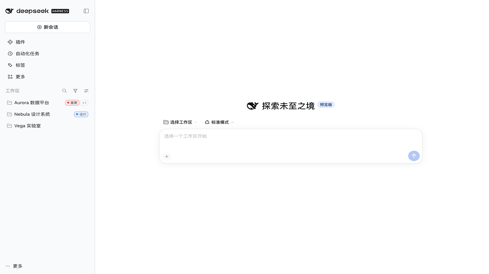
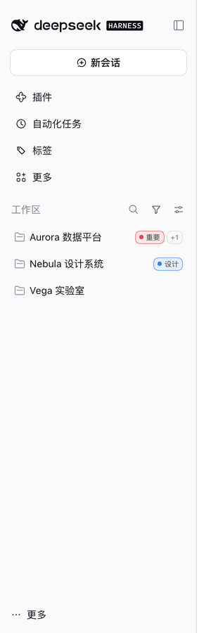
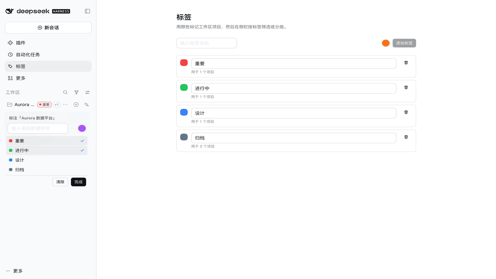
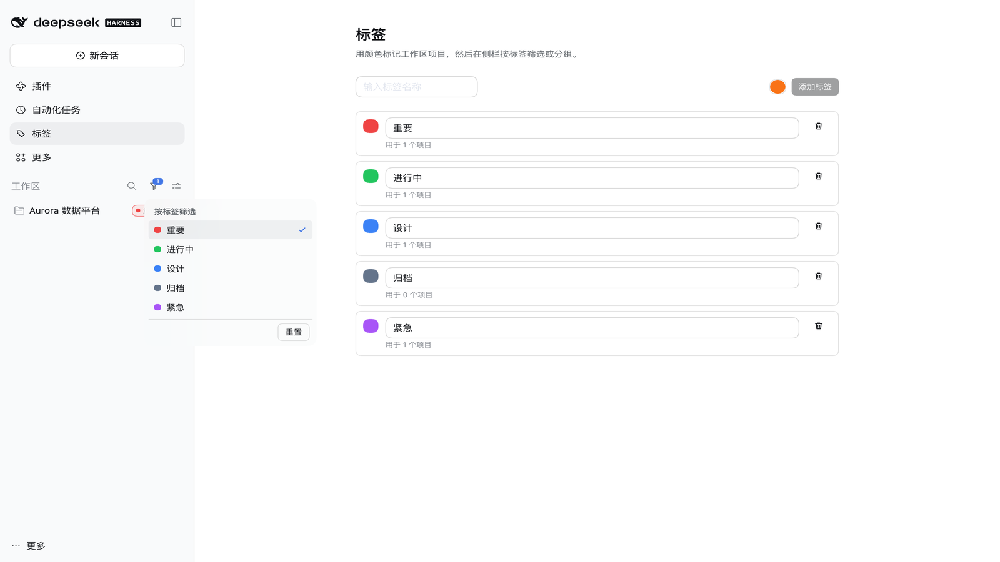
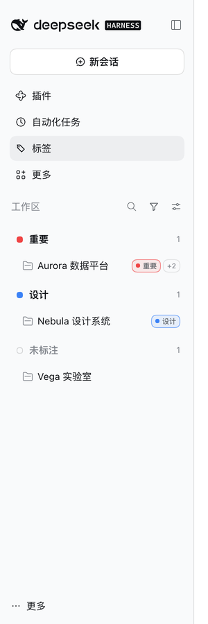
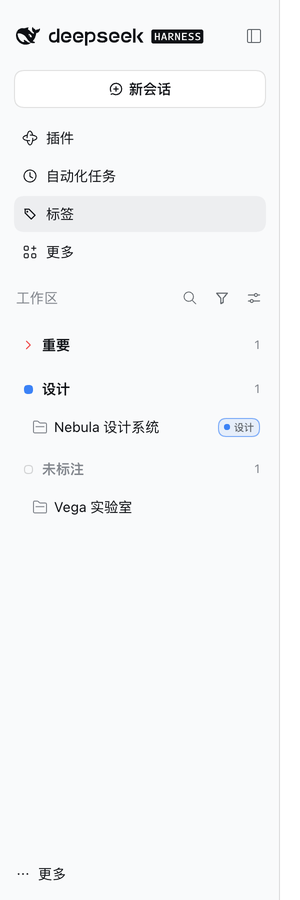
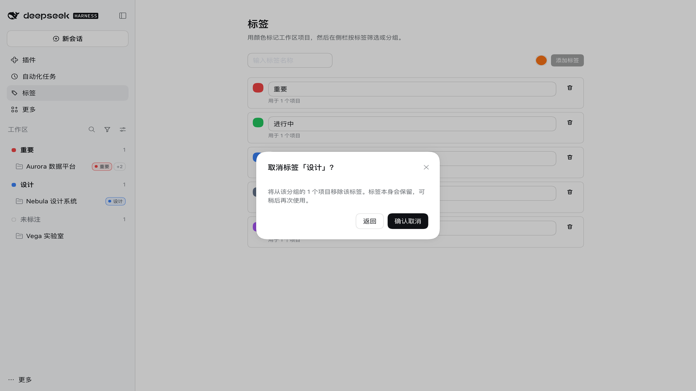
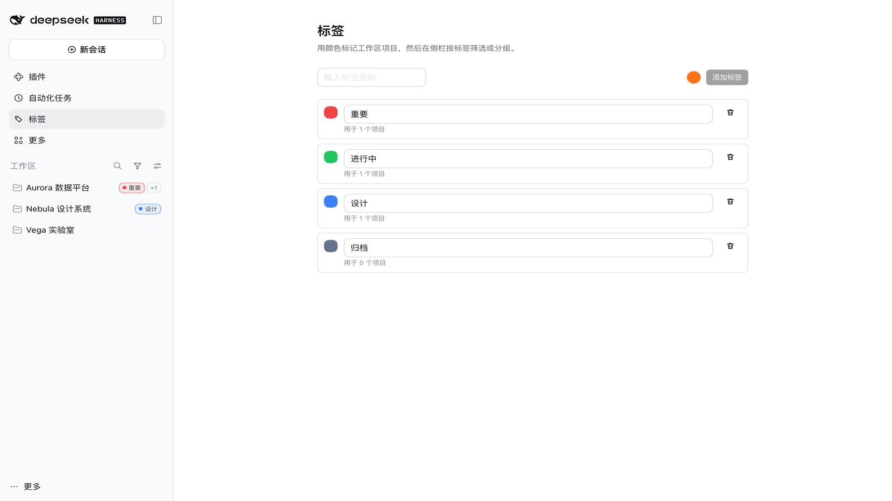

# 工作区标签 · dsh-workspace-tags

> 给 DeepSeek Harness 的左侧栏工作区加上彩色标签：项目名旁直接显示，按标签筛选，按标签分组，所有标签集中管理。

[](https://github.com/AlienGene/dsh-workspace-tags/actions/workflows/ci.yml)
[](LICENSE)
[](docs/COMPATIBILITY.md)



## 它解决什么

DeepSeek Harness 的工作区列表按项目名排列。项目一多，就很难一眼看出哪些是「重要」、哪些「进行中」、哪些是「设计」。

这个插件给每个工作区项目加上彩色标签：

- 项目名旁边直接显示标签芯片（圆形色点 + 标签色描边）
- 行内一键标注：输入新名称回车即建标签，或勾选已有标签
- 「工作区」区头的漏斗图标按标签多选筛选，底部固定「重置」
- 「分组方式」下拉新增「按标签」，工作区按标签重新分组
- 侧栏「更多」上方新增「标签」页，集中改名、改色、删除

## 功能

### 项目名旁的彩色标签



标签显示在项目名右侧：芯片里有一个**圆形色点**，芯片**边框使用标签颜色**，文字在色点之后。芯片最多显示 1 个，剩余用 `+N` 汇总；鼠标悬停可看到该项目的全部标签。

### 直接标注



把鼠标移到工作区行上，点行尾的「标签」按钮（或点已有芯片）打开标注浮层：

- 输入名称按回车：创建标签并立即指派
- **输入框旁的圆形取色器可以先选颜色**（默认取下一个未占用的调色板色）
- 名称与已有标签重复：直接指派已有标签，不会产生重复标签
- 点标签行切换指派；「清除」移除该项目的全部标签

### 按标签筛选



「工作区」区头出现漏斗图标后：

- 下拉列出全部已建标签，可多选（并集）
- 底部固定「重置」；不选任何标签 = 显示全部
- 图标右上角显示当前选中数量
- 没有匹配项目时列表内显示「没有匹配所选标签的项目」，并提供清除筛选

### 按标签分组



视图选项（「工作区」区头的滑杆图标）→ 分组方式 → **按标签**。列表按标签顺序分组；组头与原生工作区行同格式（34px 行高、色点/chevron、14px 粗体标签名、项目数），组内项目缩进一级；没有标签的项目归入「未标注」。再选任一原生分组方式即退出。

**折叠**：点组头（或键盘 Enter/Space）收起/展开该组；收起后组头保留并显示数量。



**取消分组标签**：悬停组头，点右侧「取消」；确认后从该组所有项目移除这个标签（标签本身保留，可再次使用）。



> 一个项目只出现一次：有多个标签时归入**最早创建**的那个标签（芯片仍显示全部标签）。
>
> 「取消」只移除该组项目的标签归属，不删除标签定义；在其它分组里使用同一标签的项目不受影响。删除/取消后标签页与用量会同步更新。

### 标签管理页



侧栏面板列表在「更多」**上方**新增「标签」行，打开即标签管理页：

- 新增标签（可选颜色）
- 直接编辑文字（空名、重名会行内报错）
- 点色块展开预设色板或使用系统取色器
- 删除（行内二次确认，会从所有项目中移除）
- 每个标签显示被多少项目使用

## 安装

本仓库已提交构建产物（`lib/`、`client/`），GitHub 安装不需要本地构建。

```sh
# Web / CLI profile
dsh plugin --profile web add github:AlienGene/dsh-workspace-tags
```

桌面版使用 App 自带的 CLI，并先完全退出 App：

```sh
"/Applications/DeepSeek Harness.app/Contents/Resources/runtime/cli/bin/dsh" \
  plugin --profile desktop add github:AlienGene/dsh-workspace-tags
```

安装后重新打开 App。本地开发时也可以安装目录：

```sh
dsh plugin --profile web add /path/to/dsh-workspace-tags
```

## 使用

1. 侧栏「标签」→ 添加几个标签（例如「重要」「进行中」「设计」）
2. 回到「工作区」，把鼠标移到项目行上，点行尾的标签按钮，勾选或输入标签
3. 点区头漏斗图标，多选标签筛选项目；点「重置」恢复全部
4. 点区头滑杆图标 → 分组方式 → 按标签，按标签查看项目

## 数据保存在哪里

- 标签定义与项目归属：`~/.dsh/storages/dsh_tags.json`（DSH storage-domain / JSON 后端，原子写、`0600`）
- 写入走已认证的 `/api/dsh-tags/state` 路由（仅本机 owner 可用）
- 筛选与「按标签」分组是页面状态，刷新后重置；标签数据不会因为换端口或重启丢失
- 不联网、不上传；没有遥测

## 兼容性

- 面向 **DeepSeek Harness 0.2.1-rc.5** 开发并验证，`engines.dsh` 限定 `>=0.2.1-rc.5 <0.3.0`
- 侧栏项目行、区头、视图菜单目前没有插件扩展点，插件通过 DOM 注入实现芯片、按钮、筛选图标和按标签重排；详见 [docs/DESIGN.md](docs/DESIGN.md)
- 如果 DSH 升级后侧栏结构变化，通常只需要更新 [src/client/dom/selectors.ts](src/client/dom/selectors.ts)，见 [docs/COMPATIBILITY.md](docs/COMPATIBILITY.md)

## 开发

```sh
pnpm install
pnpm run build      # tsdown：lib/ + client/client.js
pnpm run typecheck  # 宿主 + 客户端 + 测试
pnpm run test       # Vitest（协议 / 存储 / 路由 / Store / DOM / 分组 / 产物）
pnpm run check      # typecheck + build + test
```

源码全部为 TypeScript（`.ts` / `.tsx`），测试为 TypeScript + Vitest + jsdom。`lib/` 与 `client/` 是构建产物，**故意提交**以便 GitHub 直接安装；`npm run check` 之前不要手改。

目录：

```
src/index.ts               宿主入口：域存储 + 已认证路由
src/protocol.ts            共享数据模型与校验
src/host/                  存储与 HTTP 处理
src/client/index.tsx       浏览器入口：Store、同步、DOM、三个槽位
src/client/dom/            选择器、芯片、视图菜单注入、按标签分组
src/client/components/     标签页、筛选/标注浮层
test/                      Vitest
```

## 已知限制

- **DOM 增强有版本耦合**：DSH 升级可能改变侧栏类名/结构，需要更新选择器
- **单列表视图**没有项目行，筛选项会隐藏，过滤暂停
- **一个项目只在一个标签组**：多标签项目归入最早创建的标签
- **取消分组标签**只影响该组项目；若同一标签在其它分组里作为非首标签使用，那些项目保持原样
- 折叠状态、筛选与分组选择不跨刷新保存
- 选择「按标签」会先把原生分组切到「按工作区」，并持久化这个原生选择
- 仅在 0.2.1-rc.5 上做过端到端验证

## English overview

`dsh-workspace-tags` adds colored tags to DeepSeek Harness workspace projects: chips beside project names (colored dot + colored border), an inline picker that turns typed text into a tag, a multi-select filter in the workspace header, a “By tag” grouping option in the view menu, and a dedicated Tags page above the sidebar’s More row. Tags are stored locally in `~/.dsh/storages/dsh_tags.json` through the authenticated `/api` route. Tested with DSH 0.2.1-rc.5. Source is TypeScript; the committed `lib/` and `client/` make GitHub installs build-free.

## License

[MIT](LICENSE)
